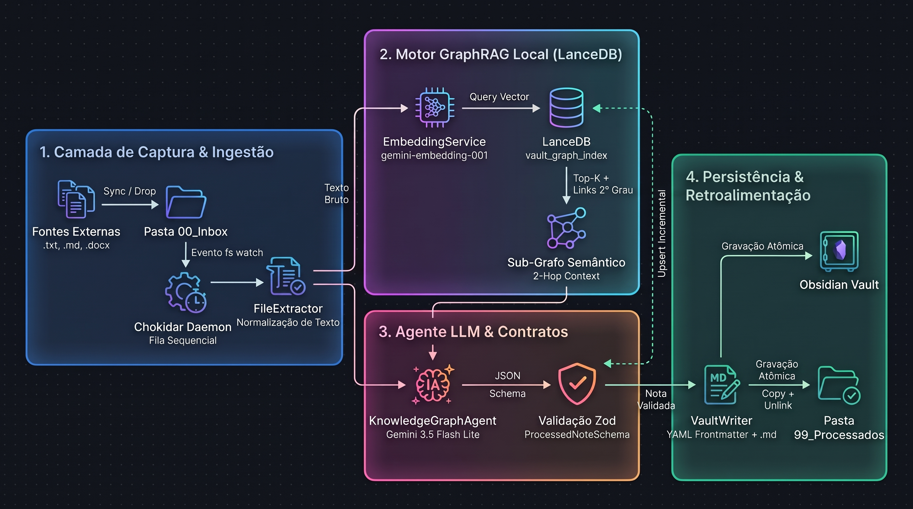

# 🧠 Obsidian GraphRAG Agent


Agente autônomo orientado a eventos para automação de **Grafos de Conhecimento (Second Brain)** no Obsidian utilizando **2-Hop GraphRAG**, busca vetorial local com **LanceDB** e síntese controlada via **Structured Outputs (Zod)**.

---

## 🎯 Contexto e Problema de Engenharia

Estudantes e engenheiros que consomem alto volume de conteúdo técnico em múltiplas frentes (Pós-Graduação, Certificações Cloud AWS, Concursos de TI e Artigos Científicos) enfrentam dois gargalos ao centralizar anotações provenientes de múltiplas fontes (Samsung Notes, Microsoft OneNote, arquivos `.txt`, `.docx`, `.pdf`, etc.):

1. **Fragmentação vs. Poluição do Grafo ("Hairball Graph"):** Separar notas apenas em pastas por origem isola assuntos correlatos (ex: uma aula de *IAM* na certificação AWS e uma nota de *Controle de Acesso RBAC* para concursos). Por outro lado, gerar `[[Wikilinks]]` automaticamente via LLM sem conhecer o estado atual do Vault cria nós duplicados (`[[AWS S3]]` vs. `[[Amazon S3]]`) e termos genéricos que degradam a topologia do grafo.
2. **Escalabilidade de Contexto ($O(N)$ para $O(K)$):** Enviar o catálogo inteiro de notas existentes no prompt da LLM funciona para dezenas de arquivos, mas escala linearmente em custo de tokens e degrada a precisão (*Lost in the Middle*) quando o Vault ultrapassa milhares de notas.

### A Solução

O **Obsidian GraphRAG Agent** atua como um daemon em background que monitora uma pasta de entrada (`00_Inbox`), extrai e normaliza o texto bruto, recupera via **LanceDB** apenas o sub-grafo semântico das $K$ notas mais próximas (incluindo suas conexões de 2º grau), e utiliza o **Gemini 3.5 Flash Lite** sob contratos estritos do **Zod** para:
* Classificar a **Origem do Conhecimento** nos metadados YAML (`origem`, `moc`, `tags`), mantendo governança e filtragem no Obsidian.
* Conectar assuntos de origens distintas injetando `[[Wikilinks]]` canônicos apontando para nós reais já existentes no sub-grafo.
* Persistir a nota formatada no Vault e atualizar incrementalmente o índice vetorial em tempo real.

---

## 🏗️ Arquitetura do Sistema



---

## ⚙️ Decisões de Engenharia e Trade-offs

| Desafio Técnico                               | Decisão Arquitetural                                                                                                                                                                                                                         | Impacto Prático em Produção                                                                                               |
| :-------------------------------------------- | :------------------------------------------------------------------------------------------------------------------------------------------------------------------------------------------------------------------------------------------- | :------------------------------------------------------------------------------------------------------------------------ |
| **Desambiguação de Nós no Grafo**             | **2-Hop GraphRAG Context:** O LanceDB armazena não só o vetor da nota, mas a lista serializada de `relacionados` (`[[Wikilinks]]`). Na busca Top-$K$, o LLM recebe os títulos das notas vizinhas **e** os conceitos que elas já referenciam. | Reduz a criação de links duplicados com grafias diferentes e mantém a complexidade de prompt constante em $O(K)$.         |
| **Condição de Corrida em Lotes (Batch Drop)** | **Fila de Promessas Sequencial (`processingQueue`):** Se 10 resumos forem soltos simultaneamente na `Inbox`, a Nota $N+1$ aguarda o `upsert` vetorial da Nota $N$ antes de consultar o LanceDB.                                              | Garante consistência imediata do grafo: notas de um mesmo lote de estudo já conseguem referenciar umas às outras.         |
| **Contratos Determinísticos de Saída**        | **Structured Outputs + `zod-to-json-schema`:** Validação em duas pontas (na geração de tokens da API via `responseSchema` e no runtime TypeScript via `ProcessedNoteSchema.parse`).                                                          | Zero falhas de formatação no cabeçalho YAML Frontmatter do Obsidian.                                                      |
| **Binários Nativos Rust no Docker**           | **Multi-stage Build com `node:20-bookworm-slim`:** Substituição do Alpine Linux (`musl`) pelo Debian Slim (`glibc`).                                                                                                                         | Compatibilidade nativa com os bindings pré-compilados em Rust/Arrow do `@lancedb/lancedb` sem overhead de compilação C++. |

---

## 📊 Avaliação Quantitativa do Pipeline (GraphRAG Eval)

Para garantir confiabilidade de produção e medir regressões de prompt, o projeto conta com uma suíte de avaliação automatizada (`src/eval/run-eval.ts`) sobre um *Golden Dataset* reproduzível, combinando **métricas determinísticas de grafo** e **avaliação semântica via LLM-as-a-Judge** (`temperature: 0.0`).

### Resumo Global de Performance (Versão: 2.0.0)

| Métrica                               | Tipo de Avaliação                 | Resultado Médio | Meta de Produção | Descrição Técnica                                                                                          |
| :------------------------------------ | :-------------------------------- | :-------------: | :--------------: | :--------------------------------------------------------------------------------------------------------- |
| **Origin Classification Accuracy**    | Determinístico (Exact Match)      |      90.0%      |     >= 95.0%     | Precisão na classificação da origem (`Concurso`, `Certificacao_AWS`, `Pos_Graduacao_1`, etc.).             |
| **Sub-Graph Link Groundedness**       | Determinístico (Anti-Alucinação)  |     100.0%      |     >= 95.0%     | Proporção de `links_existentes` gerados que de fato pertencem ao sub-grafo Top-$K$ retornado pelo LanceDB. |
| **Link Discovery Precision**          | Determinístico (Gabarito Top-$K$) |      95.0%      |     >= 80.0%     | Precisão dos links recuperados frente às conexões esperadas no gabarito.                                   |
| **Link Discovery Recall**             | Determinístico (Gabarito Top-$K$) |      58.8%      |     >= 80.0%     | Cobertura das conexões esperadas no sub-grafo inter-domínio.                                               |
| **Faithfulness (Fidelidade Factual)** | LLM-as-a-Judge (0.0 - 1.0)        |      99.5%      |     >= 90.0%     | Ausência de alucinações ou distorções conceituais em relação à nota bruta.                                 |
| **Concept Coverage (Retenção)**       | LLM-as-a-Judge (0.0 - 1.0)        |     100.0%      |     >= 90.0%     | Preservação integral dos fatos técnicos essenciais (*Key Facts*) após a síntese.                           |
| **New Concept Atomicity**             | LLM-as-a-Judge (0.0 - 1.0)        |      91.0%      |     >= 85.0%     | Qualidade e especificidade dos `novos_conceitos` criados para expansão saudável do grafo.                  |
| **Latência Média End-to-End**         | Telemetria de Sistema             |     3619 ms     |    <= 5000 ms    | Tempo médio por nota (Embedding + Busca Vetorial + Geração Estruturada).                                   |


### Detalhamento por Caso de Teste (Golden Dataset)

| Caso               | Origem Prevista                                      | Groundedness | Link Recall | Faithfulness | Coverage | Crítica do Juiz (LLM-as-a-Judge)                                                                                                                                            |
| :----------------- | :--------------------------------------------------- | :----------: | :---------: | :----------: | :------: | :-------------------------------------------------------------------------------------------------------------------------------------------------------------------------- |
| `case_aws_01`      | `Certificacao_AWS` ✅                                 |    100.0%    |    66.7%    |    100.0%    |  100.0%  | Totalmente fiel ao texto bruto e com alto rigor técnico; gera bons conceitos para o grafo, embora `AWS STS AssumeRole` carregue uma ação acoplada.                          |
| `case_aws_02`      | `Certificacao_AWS` ✅                                 |    100.0%    |    50.0%    |    95.0%     |  100.0%  | Excelente profundidade e formatação, preservando todos os fatos essenciais; a maioria dos conceitos é atômica, com poucos wikilinks estendidos além do termo ideal.         |
| `case_concurso_01` | `Concurso` ✅                                         |    100.0%    |    50.0%    |    100.0%    |  100.0%  | Fiel ao texto bruto e bem organizado; extrai conceitos técnicos precisos, mas gerou apenas dois nós diante de outros conceitos relevantes presentes na base.                |
| `case_concurso_02` | `Concurso` ✅                                         |    100.0%    |    40.0%    |    100.0%    |  100.0%  | Perfeitamente fiel ao rascunho original, cobrindo os fatos essenciais com profundidade e gerando conceitos atômicos excelentes para o grafo do Obsidian.                    |
| `case_pos1_01`     | `Pos_Graduacao_1` ✅ |    100.0%    |    66.7%    |    100.0%    |  100.0%  | Totalmente fiel ao texto original, cobre todos os fatos essenciais com precisão e utiliza conceitos atômicos específicos e altamente reutilizáveis.                         |
| `case_pos1_02`     | `Pos_Graduacao_1` ✅ |    100.0%    |    66.7%    |    100.0%    |  100.0%  | Extremamente fiel e completo na retenção dos fatos esperados, estruturando conceitos atômicos e relevantes para a topologia do grafo.                                       |
| `case_pos2_01`     | `Pos_Graduacao_2` ✅          |    100.0%    |    40.0%    |    100.0%    |  100.0%  | Totalmente fiel à origem e preciso na cobertura dos fatos; gera conceitos atômicos relevantes, apresentando apenas leves variações lexicais nos wikilinks.                  |
| `case_pos2_02`     | `Pos_Graduacao_2` ✅          |    100.0%    |    75.0%    |    100.0%    |  100.0%  | Cobertura exaustiva e fiel de todos os fatos essenciais do texto bruto, com conceitos atômicos de alta qualidade perfeitamente alinhados ao grafo.                          |
| `case_artigo_01`   | `Pos_Graduacao_1` ❌ |    100.0%    |    66.7%    |    100.0%    |  100.0%  | Alta fidelidade e cobertura total dos fatos, mas classificou a origem incorretamente e introduziu um conceito composto não atômico (`Otimização de Inferência e KV Cache`). |
| `case_artigo_02`   | `Artigo_Externo` ✅                                   |    100.0%    |    66.7%    |    100.0%    |  100.0%  | Totalmente fiel ao texto de origem e preciso na cobertura dos fatos essenciais, produzindo conceitos atômicos bem formatados para o Obsidian.                               |


---

## 📂 Estrutura do Repositório

```text
obsidian-graph-agent/
├── src/
│   ├── config/
│   │   └── env.ts                  # Validação Fail-Fast de variáveis de ambiente com Zod
│   ├── schemas/
│   │   └── note.schema.ts          # Contratos Zod (ProcessedNote, SubGraphNeighbor, VectorNoteRecord)
│   ├── services/
│   │   ├── extractor.ts            # Extração unificada (.txt, .md, .docx via Mammoth)
│   │   ├── embedding.service.ts    # Geração de embeddings densos (text-embedding-004)
│   │   ├── vector-store.ts         # Motor LanceDB (Cold-start Delta Sync, Busca Top-K e Upsert)
│   │   ├── llm-agent.ts            # Agente Gemini com Structured Outputs e Prompt 2-Hop GraphRAG
│   │   └── vault-writer.ts         # Serialização YAML Frontmatter (gray-matter) e escrita segura
│   ├── eval/
│   │   ├── golden-dataset.json     # Casos de teste multi-domínio e vizinhança simulada
│   │   ├── eval.schema.ts          # Contratos do avaliador e métricas
│   │   ├── metrics.calculator.ts   # Cálculo determinístico de Groundedness, Precision e Recall
│   │   ├── llm-judge.ts            # Auditoria semântica via LLM-as-a-Judge
│   │   └── run-eval.ts             # CLI Runner e gerador automático do EVAL_REPORT.md
│   └── index.ts                    # Bootstrap, sincronização inicial e daemon Chokidar
├── .env.example
├── Dockerfile
├── docker-compose.yml
├── package.json
└── tsconfig.json
```

---

## 🚀 Como Executar o Projeto

### Pré-requisitos
* **Docker** e **Docker Compose** (ou **Node.js 20+** para execução local)
* Chave de API do Google AI Studio (`GEMINI_API_KEY`)

### 1. Configuração das Variáveis de Ambiente

Clone o repositório e crie o arquivo `.env` a partir do template:

```bash
cp .env.example .env
```

Edite o arquivo `.env` apontando para os diretórios da sua máquina (Host):

```ini
GEMINI_API_KEY=sua_chave_aqui
GEMINI_MODEL=gemini-3.5-flash-lite

# Caminhos na sua máquina local (Host) que serão montados no Docker
HOST_INBOX_PATH=./meus_resumos/inbox
HOST_PROCESSED_PATH=./meus_resumos/processados
HOST_VAULT_PATH=/caminho/absoluto/para/seu/ObsidianVault

EMBEDDING_MODEL=gemini-embedding-001
TOP_K_NEIGHBORS=10
HOST_LANCEDB_PATH=./data/lancedb
```

### 2. Executando via Docker Compose (Recomendado)

Suba o serviço em background com build automatizado:

```bash
docker compose up -d --build
```

Para testar, adicione qualquer arquivo `.txt`, `.md`, `.docx` ou `.pdf` na pasta configurada em `HOST_INBOX_PATH`. O agente irá extrair o conteúdo, consultar os vizinhos no LanceDB, gerar a nota formatada na subpasta correspondente do seu Obsidian Vault e arquivar o original em `HOST_PROCESSED_PATH`.

### 3. Executando a Suíte de Avaliação (Benchmark)

Para reproduzir as métricas da tabela acima e regerar o arquivo `EVAL_REPORT.md`:

```bash
docker cp oexec -it obsidian-graph-agent node dist/eval/run-eval.js
```

Para fazer a cópia do arquivo `EVAL_REPORT.md` para a pasta do projeto:

```bash
docker cp ocp obsidian-graph-agent:/app/EVAL_REPORT.md ./EVAL_REPORT.md
```

---

## 🗺️ Roadmap de Evolução (MLOps & Experimentação)

- [x] **Fase 1:** Daemon Event-Driven (`chokidar`), parsers multi-formato e saída estruturada com `Zod`.
- [x] **Fase 2:** Motor **2-Hop GraphRAG** embarcado com `@lancedb/lancedb`, sincronização incremental de *cold-start* e containerização Debian Slim.
- [X] **Fase 3.1:** Pipeline de avaliação híbrida (**Determinístico + LLM-as-a-Judge**) com geração automatizada de relatórios.
- [ ] **Fase 3.2 (CI/CD Quality Gate):** GitHub Actions executando testes unitários com `Vitest` e validação de regressão de `Sub-Graph Link Groundedness` a cada Pull Request.